Getting Started
===============

This section introduces the ImageEditor graphical user interface (GUI) and guides you through the first steps of working with images. You will learn how to navigate the interface, use the main tools and perform basic image repairs.

The step-by-step instructions will help you become familiar with the essential features and get started with your own image editing tasks.

Layout of the GUI
-----------------

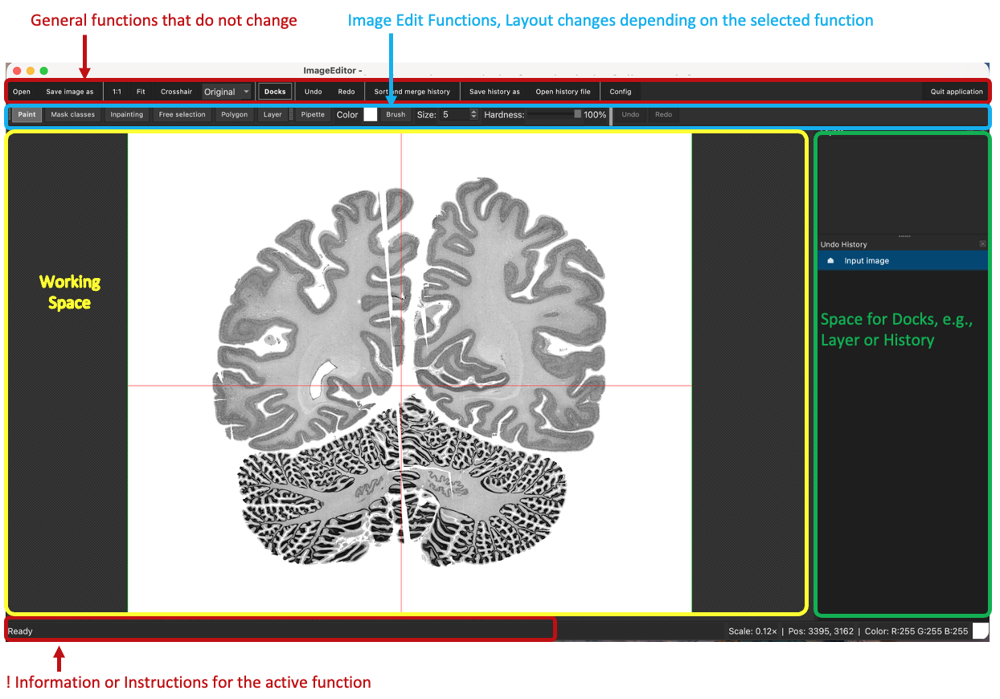

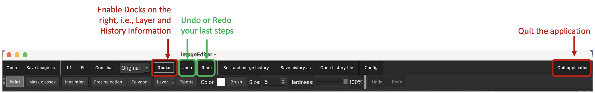

1. Load an Image
----------------

Click **Open** in the top left and load an image from your files or a
sample image, e.g. ``/ImageEditor/samples/images/pm2382o.png``.

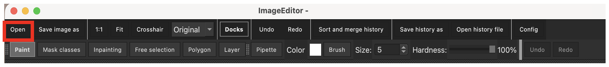

2. Zoom and Pan
---------------

* Zoom in and out with your mouse wheel.
* Shift your image view with **Shift + Left Mouse Button**.
* **1:1**: Zoom into your image's resolution with the 1:1 button in the
  top menu row.
* **Fit**: Zoom out to fit the image into your current window.

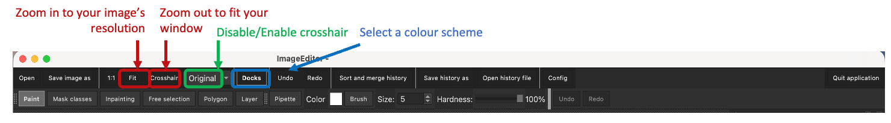

3. Create Your First Layers
------------------------

Your first select image regions you want to edit, e.g. that you want to move, rotate, transform, etc in order to restore the image as best as possible.
Each selected region defines a layer that you can edit then.

So, first lets define two layers, i.e., regions we want to edit in the follow up steps.

Lasso
~~~~~

* Selecting **Free selection** changes the corresponding menu on the right.
* Select **Create new lasso**.

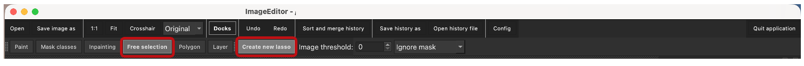

* Hold your left mouse button and draw around the image area you would
  like to edit.
* Release your mouse button when you are done.
* You have created your first layer, which is added to the list of layers
  in the **Layers** dock on the right.

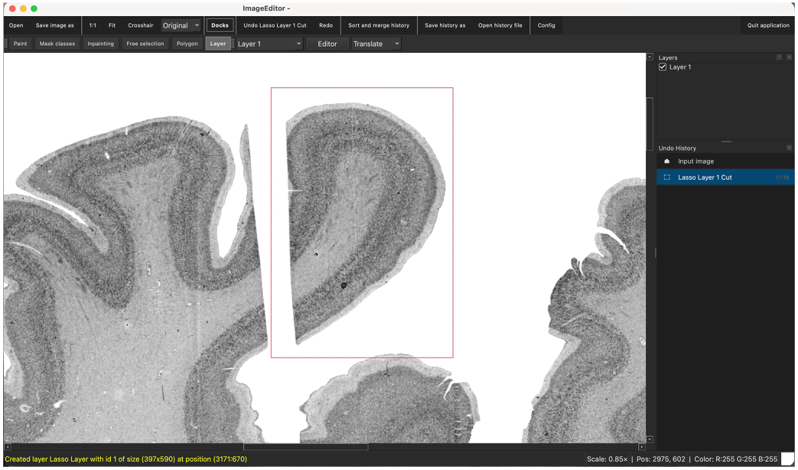

Polygon
~~~~~~~

* Selecting **Polygon** changes the corresponding menu on the right.
* Select **Create new polygon**.

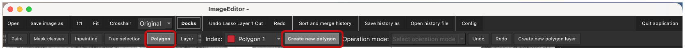

* Set a series of points around the image area you would like to edit.
  It will always be a closed polygon; add as many points as you need.
* Confirm your selection with **Esc**.

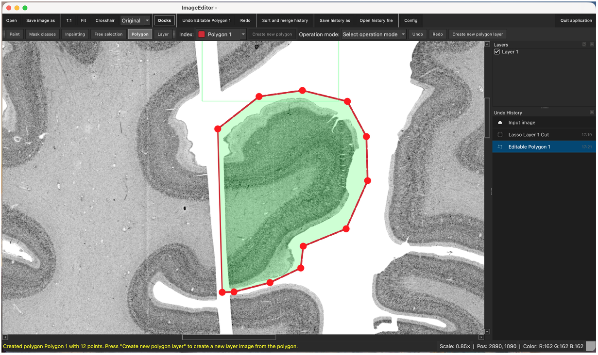

* This does not yet create a new layer. You can still edit the polygon if you are not happy.
   * E.g., add a new point by selecting from the menu 'Operation mode: > Add new polygon point' or type cmd+A (on MacOS) | strg+A (on Windows) | ctrl+A (on Linux) 
   * or Move (cmd+M) a point, or move (translate, cmd+T) the whole polygone by selecting the option from the 'OPeration mode' menu

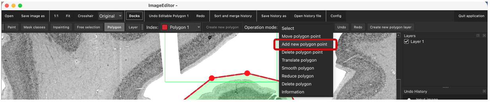

* Select **Create new polygon layer** to confirm your polygon selection
* You have created your second layer, which is added to the list of layers
  in the **Layers** dock on the right.

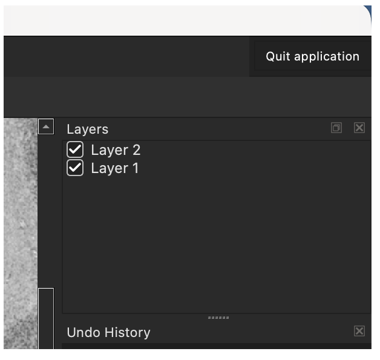

4. Edit the Layers
------------------
* Move to the first Layer again, our Lasso selection (Shift + mouse drag)
* Select Layer 1 from the Layers Dock or the **Layer** menu

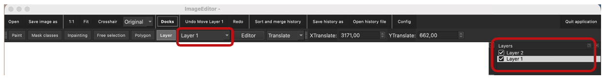

* Select **Translate** from the **Layer/Editor** menu
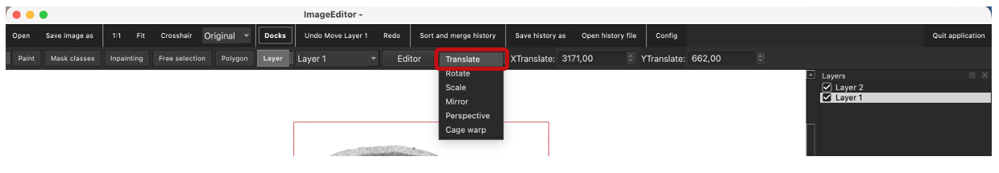

* Click into the layer and move the selected image region

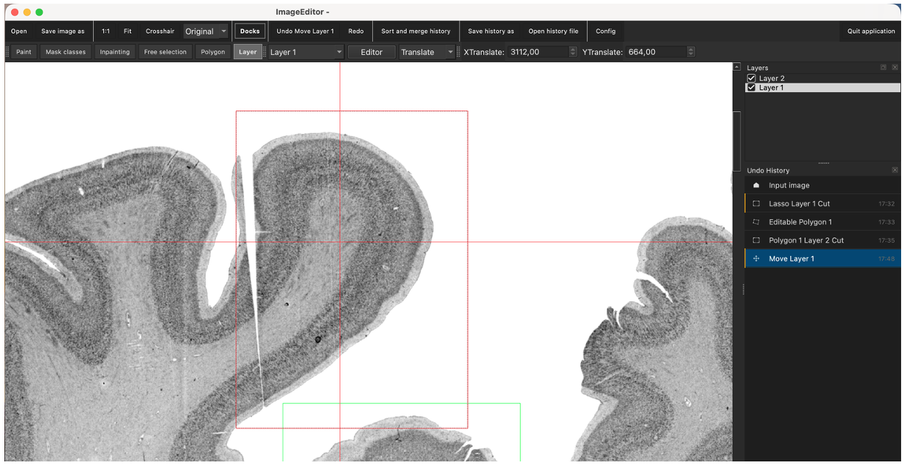

* Select **Rotate** from the **Layer/Editor** menu
* Click into the layer and move your mouse left or right to rotate the selected image region

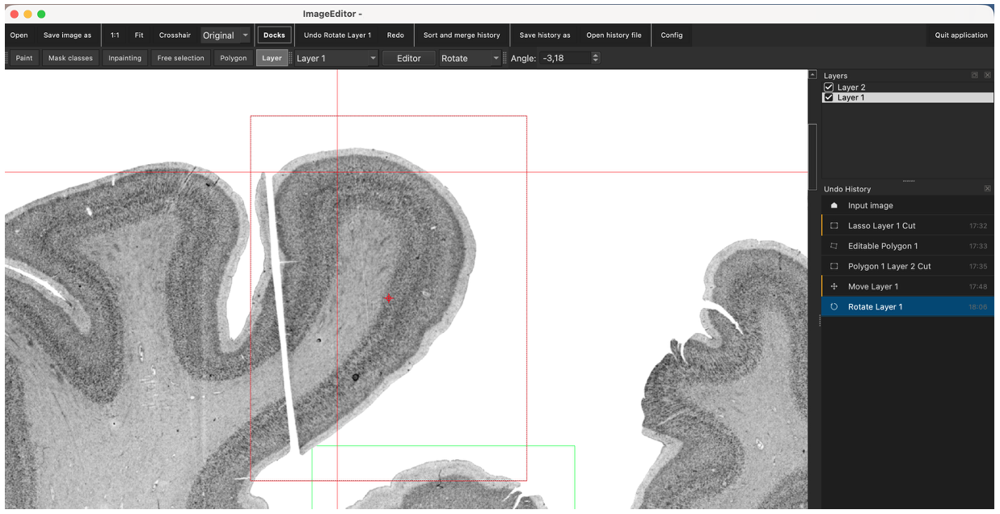

* Translate again
* For the final touch, select **Cage warp** the **Layer/Editor** menu
* Increase the number of **Cage control points**

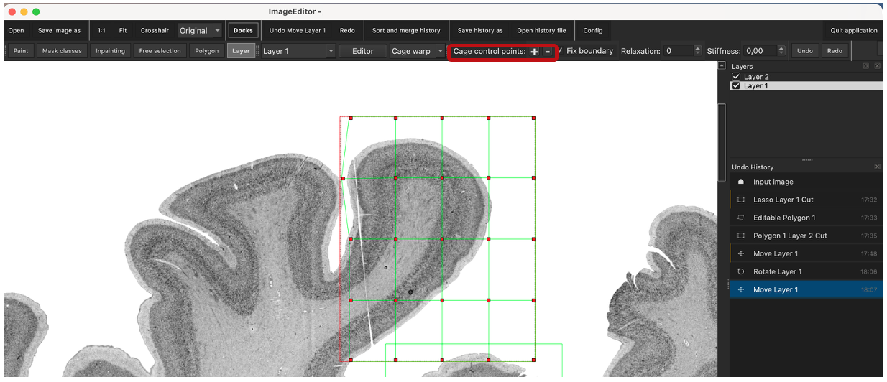

* Zoom in and move cage control points, such that the gap is closed

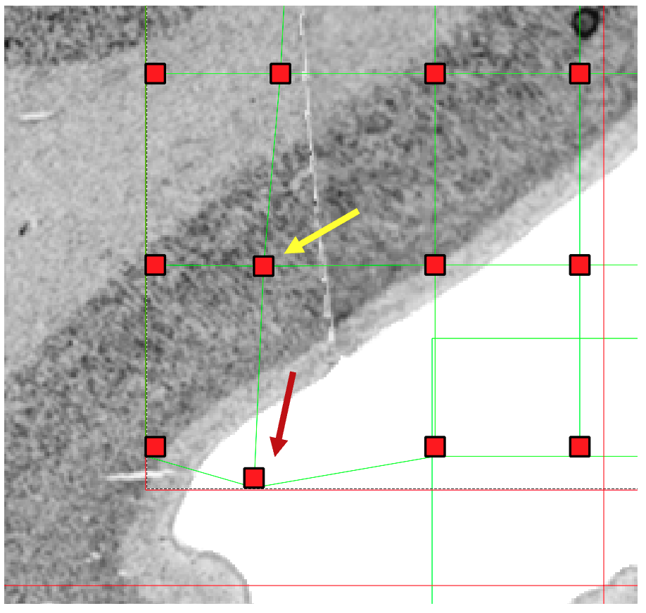

* Save your image as png-file and the history as json-file to ensure provenance tracking

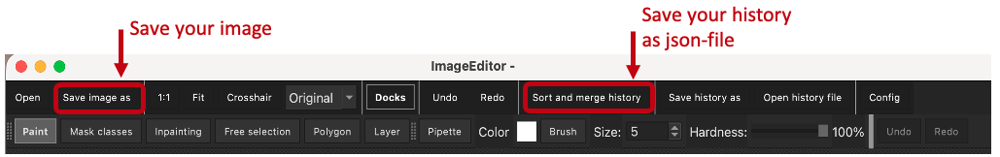

* For a complete provenance tracking add some meta data, i.e., your full name and comments if there is anything specific about your repair
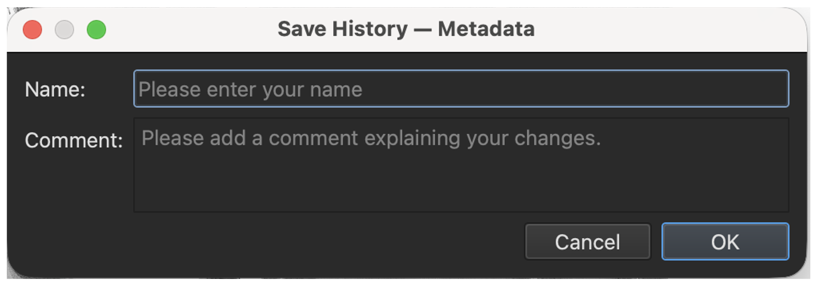

